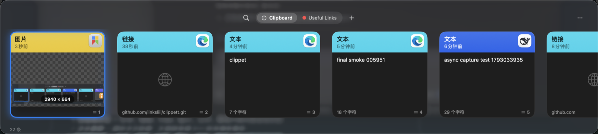

<p align="center">
  
</p>

<h1 align="center">Clippet</h1>

<p align="center">
  原生 macOS 剪贴板管理器<br/>
  <sub>卡片式浏览 · 即时搜索 · 零第三方依赖</sub>
</p>

<p align="center">
  <a href="https://github.com/linksliii/clippet/releases/latest/download/Clippet.app.zip">
    
  </a>
</p>

<p align="center">
  
  
  
  
  
</p>

<p align="center">
  
</p>

---

## 为什么是 Clippet

macOS 只保留**最后一次**复制。你复制了一段代码、又复制了一个链接，那段代码就没了。

Clippet 把每一次复制都留下来，并且让你在两秒内找回它：按下 `⌘⇧V`，面板从屏幕底部滑出，需要的卡片已经在最前面；不确定在哪，敲几个字，命中的词会直接高亮出来。

它没有账号、没有云同步、没有任何网络请求——所有数据只躺在你本机的一个 SQLite 文件里。

## 功能

**浏览**
横向卡片轮播。每张卡的头部按**来源 App 的品牌色**着色，所以同一批材料一眼就能看出是从哪来的。卡片按类型呈现：文本左对齐、图片棋盘格加尺寸徽标、颜色满铺加 HEX、文件带系统图标、链接显示域名。

**搜索**
子串匹配，不要求从词首开始——搜「优化」能在「……笔记本优化教程」中间命中；中英文混排同样有效。命中词在卡片正文里高亮，并且**卡片会自动定位到命中处**，而不是永远显示开头。查询跨所有面板。

**组织**
多面板（Pinboard）分类，卡片头部改用面板颜色与名称；`⌘` 点选、`⇧` 连选，批量复制 / 固定 / 删除。

**粘贴**
`⌘1`–`⌘9` 直接粘贴第 N 条；`⌥↵` 纯文本粘贴；粘贴堆栈把连续复制的几条一次性按顺序贴出；空格打开全尺寸预览。

**隐私**
按应用排除（列表自动取自已记录的来源）、忽略临时内容、忽略敏感内容（密码 / 密钥 / Token 通过正则识别，命中即不入库）。

**外观**
macOS 26+ 直接用系统的 `NSGlassEffectView` 液态玻璃；旧系统回落 `NSVisualEffectView` 毛玻璃。

## 安装

**方式一**：点下面的按钮下载，解压后拖入「应用程序」。

<p align="center">
  <a href="https://github.com/linksliii/clippet/releases/latest/download/Clippet.app.zip">
    
  </a>
</p>

**方式二**：自行构建

```bash
git clone https://github.com/linksliii/clippet.git
cd clippet
./build.sh          # 只需要 Command Line Tools，不需要 Xcode
open build/Clippet.app
```

首次运行需在 **系统设置 → 隐私与安全性 → 辅助功能** 中勾选 Clippet，否则自动粘贴（模拟 ⌘V）不可用。

## 快捷键

| 动作 | 快捷键 | 动作 | 快捷键 |
|---|---|---|---|
| 呼出 / 收起面板 | `⌘⇧V` | 预览选中项 | `空格` / `⌘Y` |
| 粘贴堆栈 | `⌘⇧C` | 移动选择 | `←` `→` |
| 切换面板 | `⌘←` / `⌘→` | 粘贴 | `↵` |
| 快速粘贴第 N 条 | `⌘1` – `⌘9` | 删除所选 | `⌫` |
| 纯文本粘贴 | `⌥↵` | 全选卡片 / 文字 | `⌘A` / `⌃A` |
| 逐层关闭 | `esc` | 打开设置 | `⌘,` |

## 性能

5000 条历史下的实测值（`--bench`，本机 M 系列芯片）：

| 操作 | 耗时 |
|---|---|
| 插入 | 0.088 ms / 条 |
| 列表查询（300 条） | 1.9 ms |
| 搜索（整词 / 子串 / 双词） | 1.1 / 1.2 / 2.0 ms |
| 20 MB 文本分类 | 342 ms（工作线程，不阻塞 UI） |
| 缩略图缓存命中 | < 0.01 ms |
| 物理内存占用 | 34.5 MB（面板打开 35.8 MB） |
| 50 条 2 MB JSON 的列表查询 | 6.4 ms |

**内存**：物理占用（Physical footprint，活动监视器显示的就是这个值）空闲 **34.5 MB**，面板打开时 35.8 MB。180 轮面板开合后收敛，无泄漏。

## 架构

```
Sources/Clippet/
├── App/        应用装配、面板窗口、主菜单、状态栏
├── Core/       SQLite 存储、内容分类、图像归一化、剪贴板监听
├── UI/         卡片轮播、设置页、筛选器、预览窗、搜索框桥接
└── Support/    全局热键、按键路由、设置模型、图标
```

- **存储** — SQLite（手写薄封装）。列表查询只读 400 字符的 preview 列，正文和图片按需懒加载，因此历史里堆着大文件也不会拖慢滚动。
- **捕获** — `NSPasteboard.changeCount` 轮询（0.2 s）。主线程只做字节拷贝，解码 / 哈希 / 正则全部在工作队列完成。
- **图像** — ImageIO 解码归一化，长边上限 2560 px、PNG 上限 8 MB，缩略图按字节限流。
- **窗口** — 自下而上的滑入动画由 `NSAnimationContext` 驱动；玻璃材质交给系统视图，SwiftUI 层不重复裁剪。

## 开发

```bash
swift build
./build.sh      # 签名并安装 build/Clippet.app
```

## 隐私

所有内容仅存于 `~/Library/Application Support/Clippet/clippet.db`。无网络请求、无遥测、无账号、不上传任何数据。

## 已知限制

- 数字键让位给输入法，快速粘贴需配合 `⌘`
- 快捷键为固定键位，尚不支持自定义录制
- 大批 JSON（约 100 MB）下的深处子串搜索约 20–35 ms，源自 `LIKE` 全扫；再快需要 trigram 索引，代价是写入变慢与库膨胀
